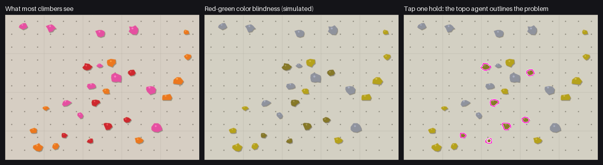

# topo-agent(日本語)

**ホールドを1つタップすると、課題のホールドが全部そろう。**

ボルダリングジムのためのトポエージェント。Meta Global AI Developer Hackathon(2026年10月27日〜11月4日)で作っている。
壁の写真を撮って、ホールドを1つタップする。**SAM 3.1** がホールドを全部囲み、**Muse Spark** のエージェントが、
道具(調べる・比べる・拡大して見る)を使って、同じ課題のホールドだけを選ぶ。
できたトポは、クライミングアプリ [Mirai Climbing](https://mirai-climbing.com/) で共有できる課題になる。

くわしい説明は英語の [README.md](README.md) にある(仕組みの図、歯止め、動かし方)。

## なぜ作るのか

**クライミングアプリでは、まず課題を登録する必要がある。** ジムのクライマー向けのアプリでは、ジムの課題を見つけたり、
登った記録を付けたり、共有したりできる。でもその前に、誰かが課題ごとにトポ(ホールドに印を付けた壁の写真)を作らないといけない。
ホールドを1つずつ手で印を付けるのは時間がかかるし、ジムの壁は何度も作り直されるので、追いつくのは大変。

課題の登録を1回のタップで済むようにして、どのジムのどのクライマーでもできるようにしたい。ホールドを1つタップすると、
トポエージェントが課題全体を囲む。クライマーはそれを確かめ、必要ならホールドを直して、アプリで共有する課題として保存する。
同じ課題に何度も印を付けなくてよい。

Mirai Climbing は、もともと一緒に登る仲間を探すために始めた。仲間探しだけでは使う人が少ないので、
クライマーが毎回使うトポに軸を移した。共有した課題は、クライマーどうしが出会うきっかけにもなる。

### 色を見分けにくいクライマーにも役立つ

1つの課題のホールドは同じ色(か同じ色のテープ)で、クライマーはそれで、どのホールドを使えるかを知る。
でも色覚の多様性は珍しくない。赤緑の型は、北ヨーロッパ系の男性の最大約8%、日本人・中国人の男性の約4〜6.5%にあると言われる
([総説](https://www.ncbi.nlm.nih.gov/pmc/articles/PMC12385717/))。日本の男性ではおよそ20人に1人。
トポエージェントは色に頼らず輪郭で課題を囲むので、色を見分けられなくても課題が見える。

## なぜエージェントか

ジムの課題は、同じ色のホールドか、ホールドのそばの同じ色のテープで示される。色だけで探すと、次の場面で間違える。
- となりの壁に、同じ色の別の課題がある
- テープの課題(ホールドの色はばらばら)
- 光のむら、ハリボテの下の影、光って白っぽく見える所

エージェントは写真を見て決める。色は道具の1つで、答えそのものではない。

## 今の結果

### 本物のジムの写真:本当の試験で、今いちばん取り組んでいること

公開されているクライミングジムのデータ(CC BY-SA 4.0)の、印の付いた写真8枚にある68課題すべて。
`python -m topo_agent.eval --photos` で測り、チームの[スコア表](docs/leaderboard.md)に出した。それぞれ1回ずつ。

| 方法 | 見つけた割合 | 当たりの割合 | F1 | 1枚の秒数 |
|---|---|---|---|---|
| **`meta`:SAM 3.1 + Muse Spark のエージェント** | **60%** | **68%** | **0.64** | **31** |
| `yolo3s-tapfix`:三段階。YOLO で切り出し、色の分布のヒント、タップの取りこぼしの救済(試作) | 60% | 60% | 0.60 | 17.4 |
| `meta3`:三段階。1回で決める + DINOv2 のヒント(試作) | 57% | 57% | 0.57 | 16 |

三段階の方法([`topo_agent/pipeline.py`](topo_agent/pipeline.py))は、エージェントのように何度もやりとりせず、
Muse Spark を1回だけ呼ぶ。見つけた割合はエージェントと同じで、時間は約半分。YOLO が写真ごとの SAM の切り出しの代わりをし、
色の分布のヒントで1回の判断を安定させ、タップした所が検出されなかった17件も救う(前は0個で終わっていた)。
当たりの割合は、まだエージェントより低い。

その前の、1枚につき課題1つ(8課題、[E9・E13・E15](docs/experiments.md))では、`meta` は見つけた割合 49〜60%、
当たりの割合 85%。日によってぶれる。

本物の写真は、描いた壁よりずっと難しい。分かったこと([learnings](docs/learnings.md)):
- ホールドの多い壁で、選ぶのを途中でやめてしまう(一番悪い例で20個中3個)。見えていないのではなく、決め方の問題
- 候補の表を信じずに、何度も拡大して確かめ直す。時間の約9割がモデルとのやりとり
- 本物の光で色が割れる(1つの課題が「緑」と「灰」に分かれる)ので、色は描いた壁ほど頼りにならない

次は、ホールドの多い壁での見つけた割合を上げることと、時間を縮めること。ハッカソン前の方法との比較も進める。

### 描いた見本の壁:変更で悪くなっていないかの確認

プログラムで描いた難しい見本の壁(9場面 × 2、各7個、計126個)。それぞれ1回ずつ測った。

| 方法 | 見つけた割合 | 当たりの割合 | 1枚の秒数 |
|---|---|---|---|
| `color`:色だけ(ハッカソン前) | 85% | 96% | 0.8 |
| `sam_color`:SAM 3.1 + 色で絞る(エージェントなし) | 90% | 86% | 1.6 |
| **`meta`:SAM 3.1 + Muse Spark のエージェント** | **99%** | **100%** | **6.8** |
| `meta3`:三段階、モデルは1回だけ呼ぶ | 99% | 96% | 5.1 |

- テープの課題で、見つけた割合が 14% → 100%(タップしたホールドの拡大を最初に見て、テープに気づく)
- となりの壁の同じ色(twins)で、57% → 100%。色だけで絞ると当たりの割合が 58% に落ちるが、エージェントは 100%
- 見落としは、SAM が切り出さなかった光って白っぽいホールド1個だけ(light)
- 1枚 36秒 → 6.8秒(最初のメッセージで候補の表を渡す、推論の深さを low に)
- `meta3` も描いた壁ではエージェントと同じ(テープは両方7個中7個。1回の判断が約3.2秒、エージェントの1回のやりとりは約5秒)
- 注意:この見本の壁は、エージェントを直すときにも使った。なので、悪くなっていないかの確認に使い、製品の実力は本物の写真で測る

## 試し方(審査員向け)

アカウントもログインも要らない。このリポジトリだけで動く。くわしいコマンドは英語の README の「Try it (for judges)」にある。

- **鍵なし**:`python -m topo_agent.demo` で、描いた見本の壁で前に本当に動かしたときの記録を再生する(API は呼ばない。画面に RECORDED と出る)。
- **Meta Model API の鍵あり**:`MODEL_API_KEY` を設定して `--live` を付けると、SAM 3.1 と Muse Spark を本当に呼ぶ。`--photo` で自分の写真も試せる。

どちらも「AI がしたこと」(道具の使い方と、エージェントの理由の1文)を出し、課題を囲んだ絵を `demo-result.png` に保存する。
本番のアプリ(Mirai Climbing)でも動いているが、ログインが要るので、動画で見せる。

## ハッカソン中に作った部分

`topo_agent/baseline/` 以外は、ハッカソン中(2026年10月27日から)に作った。

- **`topo_agent/baseline/` はハッカソンより前のコード**。Mirai Climbing のアプリ(非公開のリポジトリ)から、
  最初のコミット(タグ `pre-hackathon`)で持ち込んだ(変えたのは import の書き方だけ)。色で輪郭を取る処理、難しい見本の壁、
  **前のハッカソンのために作った Gemini のエージェント**。比べる相手として残している
- `topo_agent/eval.py` は、アプリの評価のスクリプトから始め(最初のコミット)、ハッカソン中に `sam_color`・`meta` を足した
- ハッカソン中に新しく作った物:`topo_agent/sam.py`(SAM 3.1)、`topo_agent/agent.py`(Muse Spark のエージェント)、
  `topo_agent/demo.py`(審査員向けの試し方)、`topo_agent/pipeline.py` と `topo_agent/yolo.py`(試作の三段階の方法)、
  そのテスト、README

## ライセンス

AGPL-3.0-or-later(COPYING)
