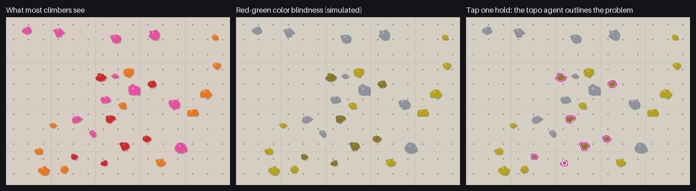
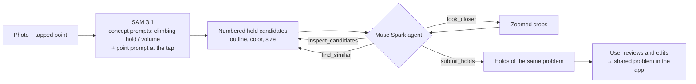

# topo-agent

**Tap one hold. Get the whole boulder problem.**

A topo agent for bouldering gyms, built for the Meta Global AI Developer Hackathon (Oct 27 – Nov 4, 2026).
Snap a photo of the wall and tap one hold. **SAM 3.1** outlines every hold, then a **Muse Spark** agent uses tools
to inspect, compare and zoom in, and picks only the holds that belong to the same problem.
The resulting topo becomes a problem that climbers can share in [Mirai Climbing](https://mirai-climbing.com/), a climbing app.



## Why we built it

**In a bouldering gym, a problem is its color.** All holds of one problem share a color (or a piece of tape), and
that is how climbers know which holds they may use. But color vision deficiency is common: red-green types affect up
to about 8% of men of Northern European descent and about 4–6.5% of Japanese and Chinese men
([review](https://www.ncbi.nlm.nih.gov/pmc/articles/PMC12385717/)), roughly one man in twenty in Japan.
So any busy gym has climbers for whom red and orange, or red and green, look nearly the same, and who have to ask
someone which holds belong to a problem.

The topo agent does the color work for them. Tap one hold, and the whole problem is outlined, so the problem is
visible without telling colors apart. The same topo is then shared with other climbers in the app, so nobody has to
mark the same problem twice.

Mirai Climbing started as a way to find climbing partners. Partner finding alone is a small market, so we moved to
topos: something every climber uses every session, and a shared problem is a natural way for climbers to meet.

## Why an agent?

In a gym, one problem is marked by holds of the same color, or by tape of the same color next to holds of any color.
A color filter alone gets this wrong in exactly the cases that matter:

- the same color appears on the next wall, in a different problem
- tape problems: the holds themselves are all different colors
- uneven light, shadows under volumes, washed-out highlights

The agent looks at the photo and decides. Color is a tool it can use, not the answer.

## How it works



1. **SAM 3.1** (Meta Model API, Responses) segments every hold with the concept prompts `climbing hold` and
   `climbing volume`, plus a point prompt at the tapped spot, all in parallel. Masks are decoded with Meta's
   `meta-sam-parser` and turned into outlines. ([`topo_agent/sam.py`](topo_agent/sam.py))
2. The agent gets the photo, a second image with every candidate outlined and numbered (so it can talk in ids instead
   of guessing coordinates), a close-up of the tapped hold (to spot tape), and a table of the candidates closest in color
   with `linked` (chained to the tapped hold by same-color holds, each gap under 30% of the photo) and `gap`.
3. **Muse Spark** (`muse-spark-1.3`, Chat Completions with tool calling) picks its own tools:
   - `inspect_candidates(ids)`: color name, hue, saturation, value, size, position, SAM confidence
   - `find_similar(id)`: candidates with a close color, closest first, with distance on the wall
   - `look_closer(ids)`: zoomed crops returned as an image (tape, shadows, highlights)
   - `submit_holds(ids, note)`: the answer, with one sentence on how it decided
   ([`topo_agent/agent.py`](topo_agent/agent.py))
4. The user always has the last word: the answer is shown as outlines the user can add to or remove.

### Guardrails

- At most 6 model turns and 8 tool calls per turn; at most 60 holds in an answer. Unknown ids are dropped,
  and the tapped hold is always included.
- An answer with fewer than 3 holds is sent back once for a second look; a text-only reply is reminded once to use
  `submit_holds`.
- Text inside the photo that looks like instructions is ignored (stated first in the system prompt).
- Only the photo and the candidates are sent. No names, no user data. Requests use `store: false`.
- If Muse Spark fails, the answer falls back to SAM candidates filtered by color (`sam_color`);
  if SAM fails too, to the pre-hackathon color-only method.
- Every step is traced (tool, arguments, result summary, milliseconds), so the app can show how the agent decided.

## Results so far

### Real gym photos: the real test, and our main work now

All 68 annotated routes on 8 photos from a public indoor climbing dataset (CC BY-SA 4.0), scored with
`python -m topo_agent.eval --photos` and submitted to the team's [leaderboard](docs/leaderboard.md). One run each.

| Method | Recall | Precision | F1 | Seconds / photo |
|---|---|---|---|---|
| **`meta`: SAM 3.1 + Muse Spark agent (on `main`)** | **60%** | **68%** | **0.64** | **31** |
| Experimental single pass + DINOv2 hints (branch `feat/three-stage`, not on `main`) | 57% | 57% | 0.57 | 16 |

Earlier runs on one route per photo (8 cases, [E9, E13, E15](docs/experiments.md)) gave `meta` 49–60% recall and
85% precision; runs wobble between sessions.

Real photos are much harder than our drawn walls. What we learned ([learnings](docs/learnings.md)):
- **It under-picks on dense walls:** the agent finds the right holds but stops early (worst case 3 of 20).
  Misses are decisions, not blindness.
- **It re-checks instead of trusting the candidate table**, zooming in again and again, so model turns take ~90% of
  the time.
- **Real light splits colors:** one route can measure as "green" and "gray", so color is a weaker hint than on drawn walls.

Next: raising recall on dense walls and cutting the time, and comparing with the pre-hackathon methods on the same
photos. The [real-route leaderboard](docs/leaderboard.md) collects complete runs from the team's experiment server.

### Drawn sample walls: our regression check

Hard sample walls drawn by code ([`topo_agent/baseline/bench.py`](topo_agent/baseline/bench.py)): 9 scenes × 2 seeds,
7 marked holds each (126 holds). One run per method.

| Method | Recall | Precision | Seconds / photo |
|---|---|---|---|
| `color`: color only (pre-hackathon) | 85% | 96% | 0.8 |
| `sam_color`: SAM 3.1 + color filter, no agent | 90% | 86% | 1.8 |
| **`meta`: SAM 3.1 + Muse Spark agent** | **99%** | **100%** | **7.6** |

- **Tape problems: recall 14% → 100%.** Hold colors are mixed and only the tape tells the problem apart. The agent looks
  at a close-up of the tapped hold first, sees the tape, and stops trusting colors.
- **Same color on the next wall (`twins`): 57% → 100% recall, without the 58% precision of a plain color filter.**
  The agent follows the chain of same-color holds from the tapped one and leaves the other group out.
- The only miss is one washed-out hold that SAM did not segment (`light`).
- Speed went from 36 s to 7.6 s per photo: the first message already carries a table of candidates (color, position,
  linked, gap), so clear cases are answered in one turn, and Muse Spark runs with `reasoning_effort: low`.
- Caveat: these walls were also used while tuning the agent, so they guard against regressions; they don't measure
  the product. Real photos do.

Every experiment, including the ones that didn't work, is in the [experiment log](docs/experiments.md).

## Run it

```bash
python -m venv .venv
.venv/Scripts/pip install -e .    # Windows; use .venv/bin/pip elsewhere
.venv/Scripts/python -m unittest discover -s tests -t .
```

Tests use a fake SAM and a fake Muse Spark, so they need no key. To call Meta Model API, set `MODEL_API_KEY`:

```bash
python -m topo_agent.sam photo.jpg "climbing hold"
python -m topo_agent.eval --bench --methods color,sam_color,meta --seeds 11
python -m topo_agent.eval --photos <dir> --methods color,sam_color,meta  # real photos: <case>.jpg + <case>.json pairs
```

## Contributing

See [CONTRIBUTING.md](CONTRIBUTING.md) (coding agents: [AGENTS.md](AGENTS.md)). Experiments and results are logged in [docs/experiments.md](docs/experiments.md).

## What was built during the hackathon

Everything except `topo_agent/baseline/` was written during the hackathon (from Oct 27, 2026).

- **`topo_agent/baseline/` is pre-hackathon code**, imported from the Mirai Climbing app (private repo) in the
  first commit, with only import paths adjusted, tagged [`pre-hackathon`](https://github.com/Mirai-Climbing/topo-agent/tree/pre-hackathon):
  the color-based outline code, the hard sample walls, and a **Gemini-based hold agent that was built for an earlier
  hackathon**. It is kept only as a baseline to compare against.
- The scoring code in `topo_agent/eval.py` started from the app's evaluation script (also in the first commit)
  and was extended during the hackathon with the `sam_color` and `meta` methods.
- New during the hackathon: `topo_agent/sam.py` (SAM 3.1), `topo_agent/agent.py` (Muse Spark agent),
  their tests, and this README. See the commit history after the `pre-hackathon` tag.

## License

AGPL-3.0-or-later (see [COPYING](COPYING)).

日本語: [README.ja.md](README.ja.md)
